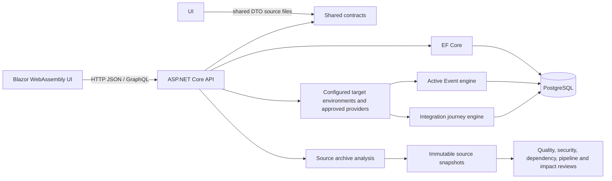

# BirkNext Codebase Guide and Audit

Audit target: `008-traceability-first` at `3b9a097467c84a1d1251bcbbe191c5c7ac0611d7`

Audit date: 2026-10-10

Method: source and documentation review, route and registration inventory, and focused static checks. No tests or builds were rerun for this audit. The integration verification recorded for this commit is summarized at the end.

Coverage limit: this is a codebase-level architecture and risk audit, not a line-by-line review of every source file, formal security assessment, or runtime penetration test. The application tree contains roughly 1,700 C# files. Findings below are tied to inspected code paths; other modules should be reviewed individually before a production certification.

## Executive summary

BirkNext is a .NET 8 application for reviewing software project evidence. It combines a Blazor WebAssembly user interface, an ASP.NET Core API, shared request/response contracts, and PostgreSQL persistence through EF Core. Its product spans document-based software delivery lifecycle (SDD) analysis, source analysis, quality and security reviews, integration configuration and testing, and environment diagnostics.

The system is strongest as an evidence collection and review workbench. It intentionally distinguishes declared source configuration from runtime observation, design-level test links from executed test results, and message acceptance from downstream verification. Many analyses are deterministic and bounded; the labels “AI-Generated Code Review” and “AI Change Review” should not be read as evidence that every review calls a model.

The principal deployment concern is that authentication is configured, but it is not the default for the API. Explicit authorization protects Active Event execution and most integration-configuration writes. The saved-workspace API still uses a shared `default-user` identity and is unauthenticated. This is a significant tenant-isolation concern if the application is exposed to multiple users or beyond a trusted local machine. Local launch settings bind to loopback, which reduces the default local-development exposure but does not establish production safety.

## System map

### Projects and runtime

- `AIAssisted/frontend/BirkNext.Web`: .NET 8 Blazor WebAssembly client. Page routes live under `Pages/`; reusable UI is under `Components/`; API clients and view models are under `Services/` and `Models/`.
- `AIAssisted/backend/BirkNext.Api`: .NET 8 ASP.NET Core API. `Program.cs` configures dependency injection, middleware, authentication schemes, PostgreSQL, controllers, GraphQL, and startup migrations.
- `AIAssisted/shared`: contract source files linked into both client and API projects by their project files. This avoids DTO drift, but is not a separately versioned shared package.
- `AIAssisted/backend/BirkNext.Api.Tests`, `AIAssisted/frontend/BirkNext.Web.Tests`, and `AIAssisted/frontend/BirkNext.Web.PlaywrightTests`: backend, component/client, and browser acceptance coverage.
- `AIAssisted/frontend/BirkNext.RealProjectAcceptance`: reusable real-project acceptance framework and runner.

The API uses EF Core with Npgsql. Startup acquires a database migration lock and applies pending migrations. The migration set is timestamped and includes designer metadata and a model snapshot. The browser uses typed HTTP services for most API operations and has GraphQL support through Hot Chocolate/StrawberryShake for selected queries.

### Evidence and state ownership

1. A project ZIP can be previewed and staged, then committed. Project documents enter the current frontend workspace; source analysis creates a source snapshot from the same staged archive.
2. The workspace artifact repository is the in-session owner of the selected SDD artifacts. Workspace persistence stores saved artifacts and lifecycle state in PostgreSQL.
3. Source Analysis stores snapshot-scoped source evidence, analyzer versions, diagnostics, and limitations. Review features consume typed evidence from the selected snapshot rather than each independently rescanning an archive.
4. Target environments and integration catalogs provide runtime configuration. Runtime review and active execution remain separate evidence types.
5. Review runs and histories are persisted selectively by feature. Persisted histories are not uniformly keyed to every input artifact or snapshot across the whole application; each feature's freshness semantics must be read from its documentation.

## Feature inventory

This inventory follows the navigation catalog and the associated application modules. Feature visibility can hide rows; navigation visibility is not an authorization boundary.

| Area | Features | Main purpose |
|---|---|---|
| Getting Started | Recommended Workflow, User Guide, Dashboard | Guide users through available evidence and summarize project/review state. |
| Project Inputs | Import Project, Sample Projects, Target Environments | Load project documents and source; configure runtime environment context. |
| Document Review | Specification, Constitution, Data Model, Plan, and Task Explorers; Document Quality Review | Parse and inspect structured SDD artifacts and report document-level issues. |
| Traceability | Requirements Traceability, Implementation Review, Implementation Traceability, Spec Drift, Impact Analysis, optional Traceability & Coverage, Traceability Suggestions, Code Traceability | Relate requirements and delivery artifacts to work items, source references, test design, execution evidence, and change impact. |
| Source Review | Source Analysis, Technology Coverage, Dependency Review, Pipeline Review, Environment Analysis (Azure provider) | Inventory source technologies, contracts, dependencies, configuration, pipelines, infrastructure, and selected cloud environment evidence. |
| Quality & Testing | Test Coverage & Overlap Review, Frontend Quality Review, API Quality Review, Integration Quality Review, Performance Test Review, Critical E2E Regression, AI-Generated Code Review | Inspect test inventory/overlap, run configured quality checks, analyze runtime and source signals, and retain review results where supported. |
| Extensions | M01 – Gradert tilgang (Kode 6/7) | M01 review of graded access and Kode 6/Kode 7 classification in M2LB (formerly named Security Classification; route `/security-classification-review`). Its classification evidence is a shared capability also consumed by Skolenærvær Testing. It is not a generic security classifier. |
| AI Review | AI Change Review | Change-oriented review feature; its exact evidence and model use depend on its configured provider and implementation. |
| Admin | System Settings | Configure visibility and local runtime settings; expose environment diagnostics and data-reset controls when enabled. |

Other backend capabilities include GraphQL and REST contract analysis, application messaging and Service Bus evidence, SCIM provisioning review, Azure environment inventory, authenticated browser sessions, browser companion/managed Edge and local HTTPS proxy support, WASM security/performance checks, accessibility and Lighthouse checks, generated documentation evidence, test execution import, and local data reset.

## How the main flows work

### SDD documents and traceability

The workspace holds a selected set of artifact roles (Constitution, Specification, Plan, Tasks, Data Model, and Research). Domain extractors produce semantic models, and `ReviewContext` derives cross-artifact references. Lifecycle revisions and baseline projections add authority/history metadata. Requirements Traceability, Implementation Review, and parts of Quality Review consume the lifecycle projection, keeping designed tests, source references, and executed test results distinct.

This is not a universal artifact-management system. The artifact slots and parsers remain oriented around supported Markdown/Spec-Kit forms. Custom requirement IDs have broader support in Specification Explorer than in every downstream traceability consumer. See [the SDD audit](birknext-sdd-audit.md) for the deeper role, authority, baseline, and evidence-gap analysis.

### Source analysis and reviews

Source Analysis accepts bounded project archives, rejects unsafe archive paths and sizes, analyzes in memory, redacts sensitive configuration values, and persists a snapshot of typed domains. Domains cover architecture, database, observability, infrastructure, configuration, CI/CD, contracts, tests, security expectations, messaging, and cross-domain links. Domain results carry status, provenance, diagnostics, and limitations. A declared cloud resource, pipeline step, or messaging channel is not presented as proof that it exists or is operating at runtime.

Consumers include Technology Coverage, Dependency Review, Pipeline Review, Integration Quality Review, source security configuration/Classification, AI-Generated Code Review, Test Coverage & Overlap Review, and Impact Analysis. Support varies by format and analyzer; `Partial`, `Unsupported`, `NotDetected`, and `NotAssessed` must not be collapsed into “passed.” See [Source Evidence Domains](source-evidence-domains.md), [Source Analysis Archives](source-analysis-archives.md), and [Generated Documentation Evidence](generated-documentation-evidence.md).

### Runtime and integration review

Target Environment settings provide the selected environment, endpoint scope, expected controls, and provider configuration. Read-only reviews inspect configuration and, when explicitly configured, bounded runtime metadata. API fuzzing is contract-bound and request-budgeted. Authenticated review uses a dedicated gateway and credential flow rather than storing user credentials in review evidence. Review docs describe safety constraints and unsupported evidence for each engine.

### Active Event and integration journeys

Active Event Testing has one lifecycle service, policy, runner, Event Hub transport, history store, and export path. Providers define domain scenarios and synthetic fixture requirements. Execution requires a backend-trusted non-production environment, approved integration destination, readiness checks, explicit user confirmation, and the `ActiveEventExecute` permission. Event payloads are generated by registered providers; arbitrary caller payloads and destinations are not accepted. A send being accepted is not downstream verification.

Integration Journeys add ordered, per-step evidence for cross-boundary flows. Packs declare journeys and prerequisites but reuse the Active Event engine for CDC; they do not create a second sender. The Skolenærvær Altinn and Bufdata flows are modeled, but their readiness documentation records missing external contracts, identities, observers, and verification surfaces. The docs explicitly treat them as not ready rather than as working end-to-end integrations. See [Active Event Testing](active-event-testing.md) and [Integration Journeys](integration-journeys.md).

## Audit findings

### F-01 — API authentication is opt-in rather than default

**Severity: High for a networked or multi-user deployment; lower for a strictly loopback-only local tool.** `Program.cs` registers JWT bearer authentication and two authorization policies, but does not configure a fallback authorization policy. The middleware calls `UseAuthentication` and `UseAuthorization`, but that alone does not require authentication. Most controllers therefore remain callable anonymously unless protected at action/class level.

Confirmed sensitive examples include the workspace persistence API and `api/admin/reset-local-database`. The reset implementation limits operation to Local database mode on Development/Local/Test backends and is controlled by `AllowLocalDatabaseReset`; those safeguards reduce the blast radius, but the controller itself has no authorization requirement. The checked-in launch profile uses `http://localhost:5000`, which is a local-development default, not a deployment-wide guarantee.

**Impact:** if the API is bound to an untrusted interface or reverse-proxied, project source/documents and review data may be read or changed anonymously; local/test reset controls may be reachable by an unintended caller. CORS only constrains browser origins and is not server-side authorization.

**Evidence:** `backend/BirkNext.Api/Program.cs` authentication/authorization setup and middleware; `Controllers/WorkspacePersistenceController.cs`; `Controllers/AdminController.cs`; `Services/AdminService.cs` reset-mode checks; `Properties/launchSettings.json`.

**Recommendation:** decide and document whether this application is strictly single-user/local. If it is networked, require authorization by default and explicitly mark only safe endpoints anonymous. Define roles for workspace ownership, admin/reset, integration configuration, and read-only reviews. Add endpoint-level authorization checks in addition to UI visibility.

### F-02 — Workspace data has a shared hard-coded owner

**Severity: High when multiple users or tenants share one backend.** `WorkspacePersistenceController.List` passes `default-user`; `WorkspacePersistenceService` initializes `_currentUserId` to `default-user` and contains TODOs to derive identity from authentication. Workspace load/rename/delete operations use workspace identifiers and do not establish the caller's ownership. Because the relevant API has no authorization policy, the database `UserId` field does not currently provide tenant isolation.

**Impact:** workspaces may be listed, loaded, or modified across user boundaries if the service is shared. A UUID workspace ID is not an authorization check.

**Recommendation:** bind the owner to a validated authenticated subject, enforce ownership in every workspace query and mutation, and add tests for cross-user access denial. If the product is intentionally local-only, state that boundary clearly and prevent network binding in the supported launcher/deployment configuration.

### F-03 — Some controllers return raw exception messages

**Severity: Medium, conditional on exposure.** Several broad catch blocks return `ex.Message` to clients. Examples include many `WorkspacePersistenceController` actions, `RecommendedWorkflowController`, `ApiQualityController`, and selected readiness endpoints. The workspace API is also unauthenticated. Other controllers in the same codebase already return generic operation-unavailable messages, so error disclosure behavior is inconsistent.

**Impact:** implementation details, database/provider errors, paths, or configuration clues can leak to callers. This is also a reliability issue because broad exception handling can turn server faults into client `400` responses.

**Recommendation:** return stable public error codes/messages, log the exception with a correlation ID, and map known validation/conflict conditions separately from unexpected server errors.

### F-04 — Several evidence paths are deliberately partial and can be misread as complete

**Severity: Product correctness / expectation gap.** Source-analysis format support is mixed; architecture rules and many integration/test relationships are explicitly heuristic or design-level. The Skolenærvær Altinn/Bufdata journeys are documented as not ready. Test Coverage & Overlap Review measures source-derived relationships and cannot prove a test ran or passed unless execution evidence is imported. Runtime acceptance, source declarations, transport acceptance, observation, and domain verification are separate states.

**Recommendation:** preserve the current evidence-state language in UI and exports. Do not summarize missing/unsupported evidence as a pass or a global percentage. Feature-specific limits are documented in the linked module docs below.

### F-05 — SDD lifecycle is improved but remains incomplete

**Severity: Product capability gap.** The SDD audit records revision history, explicit authority, baselines, lifecycle decisions, change handling, and shared evidence projections, but still identifies incomplete artifact-role inference, general conflict/exception workflows, arbitrary dialect support, symbol-level source resolution, authoritative-baseline projection limits, and test-provider gaps. Some legacy/custom-ID paths remain FR-oriented. Review [the current remaining-limitations sections](birknext-sdd-audit.md) before treating the traceability graph as universal or complete.

### F-06 — Repository has an unexplained root `NUL` file

**Severity: Low, repository hygiene.** At audit time `git status` reports an untracked root item named `NUL`. It is outside the product source inventory and was not modified. Identify its origin before deciding whether it should be ignored or removed; Windows reserves this name for a device, so scripts and tooling can treat it inconsistently.

## Documentation anomalies and limits

- `birknext-sdd-audit.md` is a chronological audit with follow-up sections. Its early baseline text says Implementation Review was a placeholder, while later follow-ups describe its replacement and subsequent evidence integration. Read the later dated follow-ups as the current state and treat early claims as historical.
- The project has useful module documentation, but no single authoritative feature-to-route-to-API-to-storage index existed at this audit target. This guide is intended to provide that entry point; it links to deeper module docs rather than duplicating every rule.
- Navigation feature visibility is configuration, not access control. It must not be used as a substitute for API authorization.
- “AI-Generated Code Review” is a deterministic source-evidence profile; its name does not mean it detects AI authorship or calls a language model. The feature's own documentation states that limitation.

## Module documentation index

- [SDD workflow and lifecycle audit](birknext-sdd-audit.md)
- [Project import](project-import.md)
- [Source Analysis archive handling](source-analysis-archives.md)
- [Source evidence domains](source-evidence-domains.md)
- [Generated documentation evidence](generated-documentation-evidence.md)
- [AI-Generated Code Review](ai-generated-code-review.md)
- [Test Coverage & Overlap Review](test-coverage-overlap-review.md)
- [Active Event Testing](active-event-testing.md)
- [Integration Journeys](integration-journeys.md)
- [API security testing](api-security-testing.md)
- [Performance Test Review](performance-test-review.md)
- [Real Project Acceptance](real-project-acceptance.md)
- [Project technology-independence audit](birknext-project-technology-independence-audit.md)

The frontend user guide is also embedded in the application at `frontend/BirkNext.Web/Pages/UserGuide.razor`.

## Verification context

The candidate `3b9a0974` was reported and verified before landing with 4,124 backend tests passed, 0 failed, 13 skipped; 5,548 frontend tests passed, 0 failed; Debug and Release builds passed; active-event and integration-journey browser acceptance passed 2/2; and the Test Coverage page smoke passed at 1440, 1100, 768, and 390 pixels with no overflow, no axe A/AA violations, and visible keyboard focus. Migration validation was reported clean on the candidate, including fresh application of all 39 migrations and an upgrade from the prior 008 database state. This audit did not rerun those checks.
